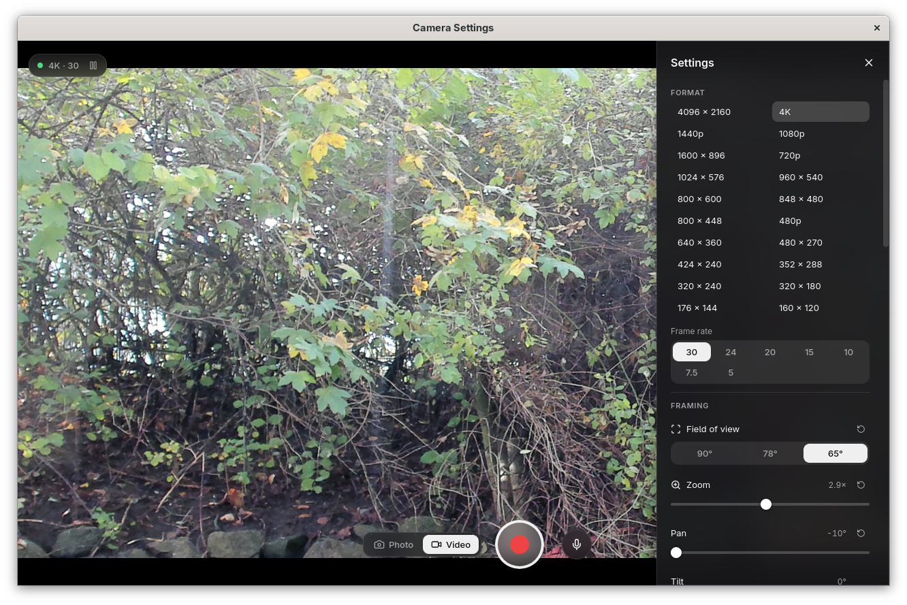

# Camera Settings

Linux desktop app for the Logitech BRIO webcam: live preview, access to the safe set of camera controls exposed over USB, including field of view, stream modes, white balance, low-level performance settings, etc. The app also allows you to make test video or still captures.

## Taking Back Control

After migrating from macOS to Linux I lost control over my Logitech BRIO web camera -- the basic functionality of the camera (recording video and sound) worked fine, but the lack of a first-party app meant I had no easy way to control settings like resolution or field-of-view. I teamed up with Claude to probe and research the capabilities of the camera exposed over USB (see [research/FINDINGS.md](research/FINDINGS.md)) and the exploration made it clear that all the important features are available over public or proprietary USB channels. Once mapped, they can be accessed from an ordinary user-space app. So, I decided to build this app and take back control.

The app was entirely implemented and tested by Claude Opus 5.5 from [SPEC.md](SPEC.md). The spec was synthesized from a short PRD that laid out the "product" ideas and main requirements.

Claude handled all coding, debugging, and testing. I directed the work according to my product vision, performed usability and acceptance testing, and assisted with yanking the physical cable out when we tested that the app could handle these kinds of disruptions.



## Build

The app was built on Fedora 44; change the dependencies installation to match whatever package manager your distro is using:

```sh
sudo dnf install gstreamer1-devel gstreamer1-plugins-base-devel webkit2gtk4.1-devel gtk3-devel \
  libsoup3-devel systemd-devel openssl-devel librsvg2-devel
npm install
npx tauri dev                           # run in development
npx tauri build --bundles rpm,deb       # target/release/bundle/{rpm,deb}/
```

Rust is managed by `rustup` via `rust-toolchain.toml` (currently 1.99.1) and Node is fetched from `asdf` and controlled via `.tool-versions` as usual.

Runtime needs GStreamer base/good/bad-free plus `pipewire-gstreamer` on Fedora, or base/good/bad plus `gstreamer1.0-pipewire` on Debian/Ubuntu (the packages declare these).

Run with `camera-settings --debug` to enable the web inspector and the webview's right-click menu.

## Install

Once built, use your local package manager to install from one of the target bundles (replace
version number with the actual one stated in [Cargo.toml](Cargo.toml)):

```
sudo dnf install "./target/release/bundle/rpm/Camera Settings-0.2.0-1.x86_64.rpm"
```

After this, the app is available in your launcher.

## Repo Layout

| Path                     | What                                                                                                           |
| ------------------------ | -------------------------------------------------------------------------------------------------------------- |
| `crates/camera-control/` | Library: sysfs discovery, udev hotplug, allowlisted V4L2 + UVC XU (FOV only) controls. No Tauri, no GStreamer. |
| `src-tauri/`             | App crate: session state machine, GStreamer pipeline, config, Tauri commands.                                  |
| `src/`                   | Svelte frontend.                                                                                               |

## Tests

```sh
npm install && npm run build                            # cargo needs dist/ to exist at compile time
cargo test --workspace                                  # unit tests, no camera needed
cargo test -p camera-control -- --ignored               # against an attached BRIO; writes allowlisted controls and restores them
npm run check
```

### Driving a debug build headlessly

Debug builds read commands from stdin when `CAMERA_SETTINGS_DEBUG_STDIN=1` is set (with `npx vite` running):

```sh
tail -f cmds.txt | CAMERA_SETTINGS_DEBUG_STDIN=1 RUST_LOG=camera_settings=debug ./target/debug/camera-settings
echo "rec audio" >> cmds.txt   # still | rec [audio] [compact] | stop | mode 3840x2160@30 | set <id> <v> | reset <id>
                               # pause | resume | hidden 0|1 | minimized 0|1 | ui drawer|info|scroll N|quit
                               # resolve adopt|apply
```

`CAMERA_SETTINGS_DEBUG_AUDIO_NODE=<node>` (debug builds) forces the recording mic, e.g. a bogus name to
exercise the mic-failure path.

### Hot-unplug acceptance tests (SPEC §6.4)

Simulate an unplug without touching the cable (`4-1` is the BRIO's USB path; see `/sys/bus/usb/devices/*/product`):

```sh
echo 0 | sudo tee /sys/bus/usb/devices/4-1/authorized   # unplug
echo 1 | sudo tee /sys/bus/usb/devices/4-1/authorized   # replug
for i in $(seq 20); do echo 0 | sudo tee /sys/bus/usb/devices/4-1/authorized; sleep 2; \
  echo 1 | sudo tee /sys/bus/usb/devices/4-1/authorized; sleep 4; done          # H9
fuser /dev/video*                                                                # H10: empty while minimised
```
